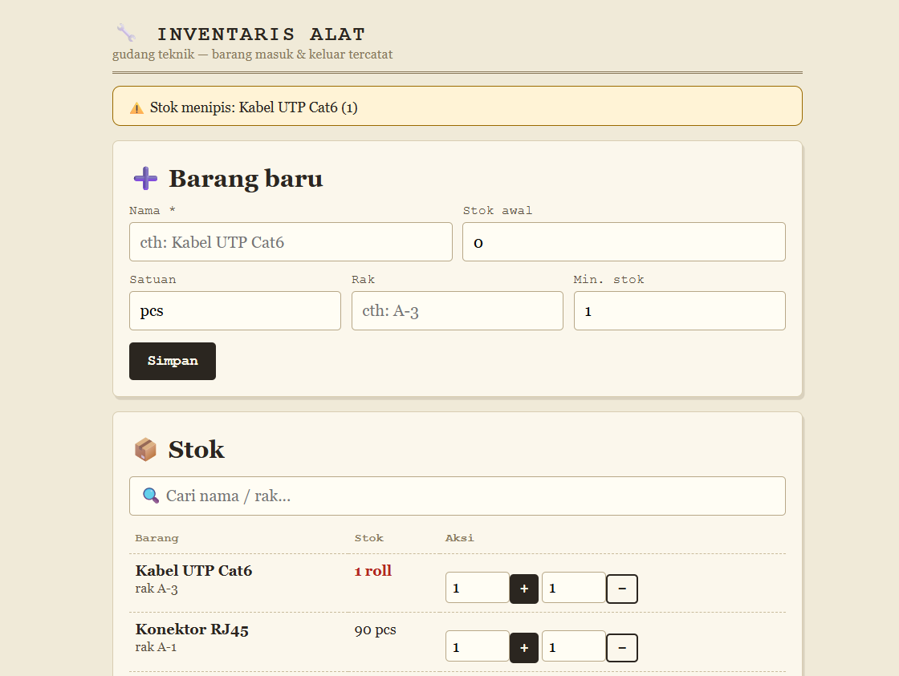

# 🔧 Inventaris Alat Teknik (PHP native)

Stok gudang teknik: barang masuk & keluar tercatat + riwayat, peringatan stok menipis. **1 file PHP + SQLite**, tanpa framework, tanpa composer.


## Fitur

- ➕ Tambah barang (nama, stok awal, satuan, rak, batas minimum)
- ➕➖ Mutasi masuk/keluar per baris + cegah stok minus
- ⚠️ Banner otomatis saat stok ≤ minimum
- 🔍 Cari nama/rak + 8 riwayat terakhir
- 📴 SQLite file — backup = copy 1 file `.db`

## Jalankan

```bash
php -S 127.0.0.1:8001 inventaris-alat.php
# buka http://127.0.0.1:8001
```



Butuh ekstensi: `pdo_sqlite`.

MIT — dulkemot 2026
